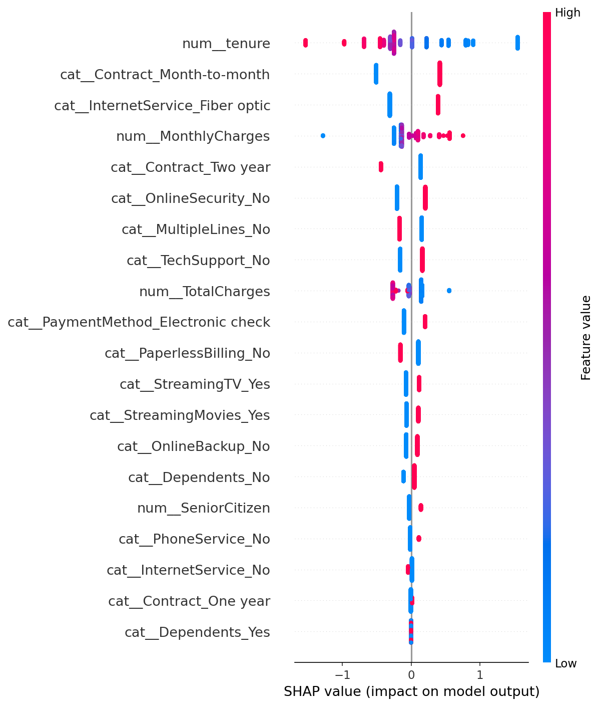
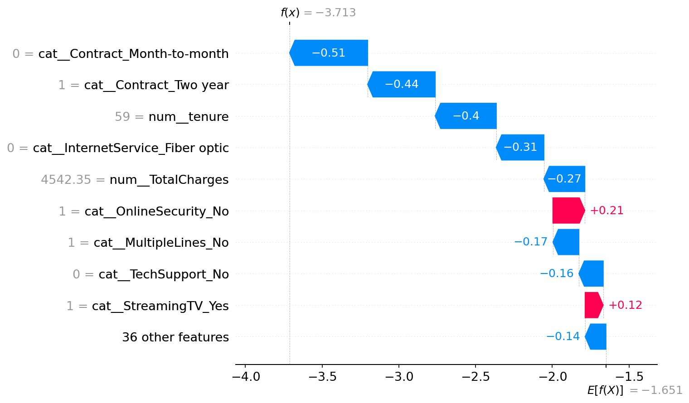

# Telco Customer Churn Prediction

Predict whether a customer will leave, using the IBM Telco dataset (7,043 customers).

## Results
| Model | Test AUC |
|---|---|
| Logistic regression (L2) | ~0.835 |
| Random Forest | 0.839 |
| Gradient boosting (tuned) | 0.841 |

## Key findings
- Top drivers: tenure, contract type, fiber optic internet.
- A simple additive model (depth-1 boosting) matches complex models,
  so the signal is mostly linear.
- Lowering the threshold to ~0.3 raises recall on churners at the cost of precision.

## Pipeline
Clean data → ColumnTransformer (one-hot) → boosting → GridSearchCV (5-fold) → joblib.

## Run it
pip install pandas scikit-learn joblib
jupyter notebook telco_churn.ipynb

## Explainability (SHAP)

Tenure and contract type drive most predictions. Short tenure and
month-to-month contracts push toward churn; two-year contracts and long
tenure push toward staying.
